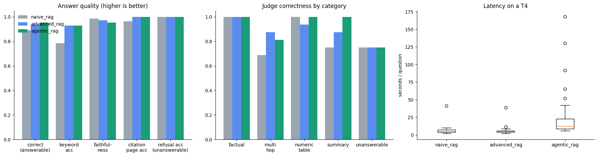
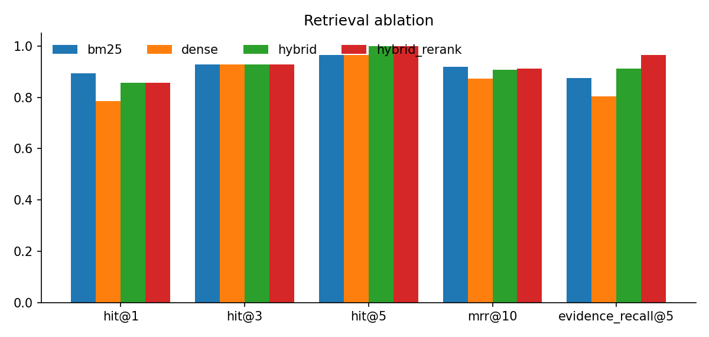
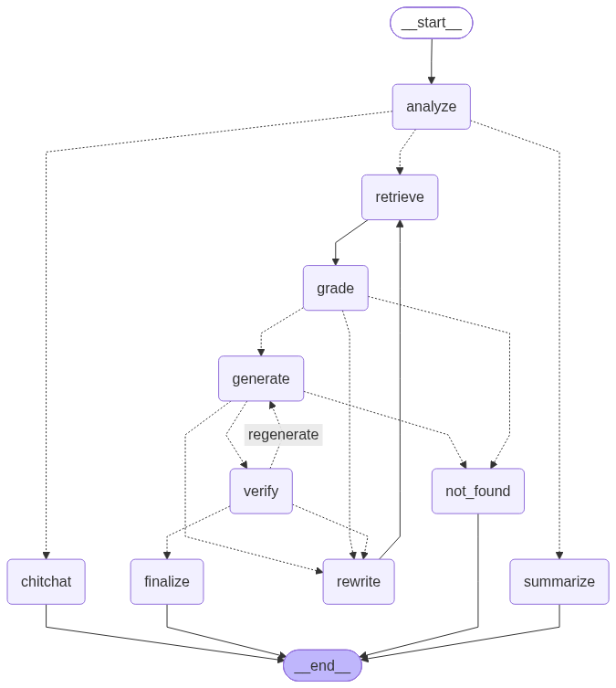

# Local Agentic RAG Chatbot for Any PDF

An open-source chatbot that answers questions about any PDF you upload. It is built as a single Google Colab notebook and runs **entirely on the free Colab T4 GPU**. It uses no API keys and no cloud LLMs.

[](https://colab.research.google.com/github/ISHANT57/agentic-rag-pdf-chatbot/blob/main/Agentic_RAG_PDF_Chatbot.ipynb)

**Deliverable:** [`Agentic_RAG_PDF_Chatbot.ipynb`](Agentic_RAG_PDF_Chatbot.ipynb) · **Results:** [`results/REPORT.md`](results/REPORT.md) · **Executed notebook with all outputs (T4 run, 2026-10-31):** [`results/Agentic_RAG_PDF_Chatbot_T4_run_2026-10-31.ipynb`](results/Agentic_RAG_PDF_Chatbot_T4_run_2026-10-31.ipynb)

## What it does

- Upload one or more PDFs: papers, reports, scanned documents, documents with tables and charts.
- Ask questions in a chat UI. Answers cite the **page numbers** they come from.
- The agent **checks its own work**. It grades retrieved passages, verifies that the answer is supported by the sources, and retries with a rewritten query when evidence is missing.
- It says so when the document does not contain the answer, instead of guessing.
- It keeps chat memory, so follow-up questions such as "which of them was best?" work.

## Results (free Colab T4, 2026-10-31)

36 questions over 4 PDFs (88 pages). LLM `qwen3.5:9b`, judge `gemma3:4b`. Full report: [`results/REPORT.md`](results/REPORT.md) · scorecard: [`results/scorecard.json`](results/scorecard.json) · per-answer scores: [`results/scored_answers.jsonl`](results/scored_answers.jsonl).

| | naive RAG | advanced RAG | agentic RAG |
|:--|--:|--:|--:|
| Correctness, answerable questions (LLM judge) | 0.906 | **0.953** | **0.953** |
| Correctness, all 36 questions | 0.917 | **0.958** | **0.958** |
| Keyword accuracy | 0.786 | 0.929 | 0.929 |
| Faithfulness (claims supported by context) | 0.969 | 0.973 | 0.954 |
| Citation page accuracy | 0.963 | 1.000 | 1.000 |
| Refusal accuracy, unanswerable questions | 1.000 | 1.000 | 1.000 |
| False refusal rate, answerable questions | 0.031 | 0.031 | **0.000** |
| Correctness on summary questions | 0.875 | 0.875 | **1.000** |
| Latency mean / p95 (s) | 6.4 / 10.5 | 6.9 / 10.2 | 29.8 / 84.9 |
| LLM calls per question | 1.0 | 1.0 | 5.3 |

| Retrieval (page-level) | Hit@1 | Hit@5 | MRR@10 | Evidence recall@5 |
|:--|--:|--:|--:|--:|
| BM25 | 0.893 | 0.964 | 0.918 | 0.875 |
| Dense (bge-m3) | 0.786 | 0.964 | 0.872 | 0.804 |
| Hybrid (RRF) | 0.857 | 1.000 | 0.907 | 0.911 |
| Hybrid + rerank | 0.857 | 1.000 | 0.911 | **0.964** |

- **Robustness suite:** 9/10 checks passed (out-of-scope refusal, prompt injection in the message and inside a PDF, chat memory, corrupt and blank files, document filter, multi-document search, chit-chat routing). The scanned-PDF check answered correctly ("1C Company"), but its OCR page counter read 0 because PyMuPDF4LLM's own OCR adds a text layer before the counter looked. The counter now measures the page before parsing; this run predates that fix.
- **Peak GPU memory:** 9.6 GB of the T4's 15 GB. **Ingestion:** 5.1 s per page, including figure descriptions.
- **Honest limits:**
  - On this test set the agent ties advanced RAG on correctness (0.953 vs 0.953; paired difference 0.000, 95% CI [-0.042, 0.042]). Its measurable gains are zero false refusals and full marks on summary questions; it trails on multi-hop (0.812 vs 0.875).
  - It costs about 4x the latency (5.3 LLM calls per question).
  - 36 questions are too few to separate the systems with statistical confidence.




## Stack (all local, all open-weight)

| Part | Choice | Why |
|---|---|---|
| LLM | `qwen3.5:9b` (Q4) via Ollama | Strong instruction following in 6.6 GB; also a vision model, so it reads figures. Falls back to `qwen3.5:4b` automatically when less than about 5 GB of system RAM is free (`RAG_LLM_LOWMEM`); the notebook prints which model is active |
| Embeddings | `BAAI/bge-m3` | Strong multilingual retrieval model |
| Reranker | `BAAI/bge-reranker-v2-m3` | Cross-encoder; gives a calibrated score used to filter weak candidates before generation |
| Sparse search | BM25 (`bm25s` + stemming) | Exact terms, numbers, acronyms |
| Fusion | Reciprocal Rank Fusion | No score calibration needed |
| Agent | LangGraph | Explicit, bounded, inspectable state machine |
| Parsing | PyMuPDF4LLM + Tesseract OCR + VLM figure descriptions | Tables as Markdown, scanned pages, charts |
| UI | Gradio | Upload, chat, live agent trace, sources |
| Judge (evaluation only) | `gemma3:4b` | Different model family from the generator, to reduce self-preference bias (fallback `qwen3:4b` is the same family) |

## Agent graph



```
analyze (condense follow-up · route · decompose)
 ├─ chitchat ──────────────► END
 ├─ summary ─► map-reduce ─► END
 └─ retrieve ─► grade ─┬─ none relevant ─► rewrite (keywords + HyDE) ─► retrieve
                       ├─ still nothing after the loops ─► not_found ─► END
                       └─► generate (cited, or NOT_FOUND) ─► verify
                                                              ├─ ungrounded ─► generate (strict)
                                                              ├─ incomplete ─► rewrite
                                                              └─ ok ─► finalize ─► END
```

Every loop is bounded by `max_iterations`. Every control decision uses a JSON-schema-constrained LLM call, so small models cannot break the control flow with badly formatted output.

## Benchmark

`benchmark/gold_qa.json` holds 36 hand-written questions over 4 public PDFs:
- Attention Is All You Need
- the RAG paper (Lewis et al., 2020)
- the sales-forecasting paper used by the reference notebook (arXiv 2008.07779)
- the 48-page NIST AI Risk Management Framework

Each document has 3 factual, 2 numeric/table, 2 multi-hop, 1 summary, and 1 unanswerable question. Every answerable question has gold page numbers and verbatim evidence quotes. Cell 10.2 checks every quote against the indexed text of its PDF and prints how many it found.

The notebook compares three systems: **naive RAG** (dense top-5, one LLM call), **advanced RAG** (hybrid + rerank, one call), and the **agentic RAG**. It reports:

- **Retrieval**: Hit@1/3/5, MRR@10, Evidence Recall@5, with an ablation of BM25 vs dense vs hybrid vs hybrid+rerank.
- **Answers**: LLM-judge correctness, keyword accuracy, token F1, semantic similarity.
- **Faithfulness**: claim-level support by the retrieved context.
- **Refusals**: refusal accuracy on unanswerable questions and false refusal rate on answerable ones.
- **Citations**: citation page accuracy.
- **Efficiency**: latency (mean / p50 / p95), LLM calls, tokens, peak VRAM, ingestion speed.
- **Statistics**: 95% bootstrap confidence intervals, paired agentic-vs-baseline difference, judge-vs-keyword agreement.
- **Robustness**: scanned-PDF OCR, out-of-scope refusal, prompt injection (user message and hidden inside a document), chat memory, corrupt and blank uploads, document filter, multi-document search.

All results are saved to `rag_data/benchmark/` (`REPORT.md`, CSVs, charts, raw answers).

## Run it

1. Open the notebook in Colab with the badge at the top, or `File → Upload notebook`.
2. `Runtime → Change runtime type → T4 GPU`.
3. `Runtime → Run all`.
   - Setup takes about 5–7 minutes.
   - The Gradio link appears in section 9.
   - The benchmark (section 10) is **on by default**: it downloads a judge model and 4 PDFs and takes 30–40 minutes. Untick `RUN_BENCHMARK` in cell 10.0 to skip it, or set `RAG_BENCH_LIMIT=12` for a quick run.
   - Section 13 zips the report, CSVs, charts and raw answers and downloads the zip. It also copies the results to `MyDrive/agentic_rag_results`, so Colab asks once for Google Drive access; if nobody answers, the copy is skipped.

Settings can be overridden with environment variables set before running:

| Variable | Default | Effect |
|---|---|---|
| `RAG_LLM` | `qwen3.5:9b` | Main model, e.g. `qwen3.5:4b` for faster answers |
| `RAG_JUDGE` | `gemma3:4b` | Evaluation judge |
| `RAG_FIGURES` | `1` | `0` turns off figure descriptions (faster ingestion) |
| `RAG_DATA_DIR` | `/content/rag_data` | Point at Google Drive to keep the index across sessions |
| `RAG_BENCHMARK` | on | `0` skips section 10, `1` forces it on (same as `RUN_BENCHMARK`) |
| `RAG_BENCH_LIMIT` | `0` | Number of benchmark questions (0 = all) |
| `RAG_LLM_LOWMEM` | `qwen3.5:4b` | Model used automatically when system RAM is too tight for the main model |
| `RAG_SHARE` | `1` | `1` makes a public `gradio.live` link (anyone with the link can use the app); `0` keeps it local |
| `RAG_NUM_CTX` | `12288` | Context window in tokens |

In Colab, set them in a new cell before cell 2.1, for example `%env RAG_LLM=qwen3.5:4b`.

## Development

- `notebook_src.py` is the source of truth, in jupytext percent format, so diffs are easy to read.
- Build the notebook with `python scripts/build_notebook.py`. This also embeds the gold set.
- Smoke-test on a CPU-only machine without Ollama. Test mode skips the installs, so first install the packages from cell 1.2 plus `torch` (CPU), `pandas`, `matplotlib`, `jupyter` and `jupytext`:

  ```bash
  python tests/mock_ollama.py &          # fake Ollama API: exercises every code path, no quality signal
  RAG_LOCAL_TEST=1 RAG_BENCHMARK=1 RAG_EMBED=BAAI/bge-small-en-v1.5 \
  RAG_RERANK=cross-encoder/ms-marco-MiniLM-L-6-v2 RAG_BENCH_LIMIT=8 \
  jupyter nbconvert --to notebook --execute Agentic_RAG_PDF_Chatbot.ipynb --output /tmp/smoke.ipynb
  ```

## License

MIT. Model licenses: Qwen (Apache-2.0), bge-m3 (MIT), bge-reranker-v2-m3 (Apache-2.0), Gemma (Gemma Terms of Use; used only as the evaluation judge), Llama 3.1 (Llama 3.1 Community License; text-only fallback if Qwen cannot be pulled).
